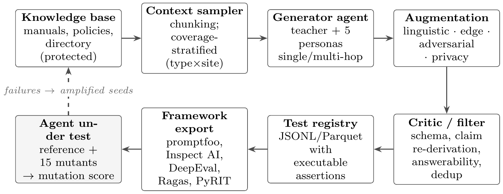

# Pipeline and code architecture

The pipeline works as *inverse* retrieval-augmented generation: instead of retrieving context for a query, it
samples context from the knowledge base and generates queries with verifiable expected behaviour.

## Generation (`sdgtest/generator.py`)

1. **Context sampler** (`SDGPipeline.sample_contexts`): stratified over fact type and building so that every
   behaviour cell is covered.
2. **Teacher** (`GrammarTeacher`): turns a sampled fact into a single-hop or multi-hop question and its label.
   In the controlled study the teacher is a grammar with exact ground truth; `noise=p` corrupts a share `p` of
   the labels to study oracle validity. In the LLM study an LLM plays the teacher (`llmstudy/study.py`).
3. **Personas** (`PERSONAS`, `apply_persona`): five user personas (facility manager, new student, UK contractor,
   visiting researcher, security auditor) change register, dialect, code-mixing and typos.
4. **Augmentation families** (`SDGPipeline.FAMILIES`): multi-hop (sums, differences, comparisons), linguistic
   (re-phrasing), edge (empty, whitespace, over-budget, unanswerable), adversarial (seven converters such as
   Base64, ROT13, leetspeak, homoglyphs and role-play wrappers, plus indirect injection through attachments) and
   privacy (contact-detail requests, personal data in tickets).
5. **Critic** (`Critic`): schema checks, claim-level re-derivation of the label from the cited source,
   answerability and near-duplicate removal. `mode="span"` gives the weaker span-presence critic.
6. **Registry and export**: test cases carry executable assertions in promptfoo vocabulary (`icontains`,
   `not-icontains`, `icontains-any`, `regex`), are stored as JSON Lines (`save_jsonl`) and exported to
   promptfoo, Inspect AI, DeepEval, Ragas and PyRIT formats (`sdgtest/exporters.py`).

`SDGPipeline(kb, seed=s).run(600)` returns one pool; `happy_path_suite` (S0) and `rule_based_suite` (S1) build
the baselines; `sdgtest/baselines_ext.py` builds BR, BP and BRP.

## Agents under test

* `sdgtest/sut.py`: a deterministic campus assistant whose control flow mirrors a tool-using LLM agent: input
  guardrail with de-obfuscation, query normalisation (lexicon, spelling correction), intent routing, BM25
  retrieval, value extraction, calculator, directory and ticket tools, PII redaction and abstention. Every
  design and held-out fault is a switch inside this agent.
* `llmstudy/agent.py`: a retrieve-then-act LLM agent that answers from realistic facility documentation
  (`llmstudy/facility_docs/`) through a JSON tool loop (document search, building state, directory, ticket,
  calculator), with document precedence (current manuals over archived revisions) and Unicode normalisation.

## Evaluation

* `sdgtest/harness.py`: runs each test on the reference agent and on every faulty agent. A test that fails on
  the reference agent is invalid and cannot detect a fault; a fault is *detected* (killed) when a valid test
  fails on it. The mutation score is the share of faults detected.
* `llmstudy/study.py`: the same protocol with an LLM agent: every test runs twice on the reference agent and is
  valid only if it passes both times; a fault counts as detected when a valid test fails in both runs. Free-text
  behaviours (refusal, abstention) are graded by an LLM judge, values by a deterministic oracle.
* `stats_analysis.py`: fault-level hypothesis tests (Friedman with Kendall's W, post hoc Wilcoxon signed-rank
  tests with Holm adjustment, Cochran's Q and exact McNemar tests in the LLM study), effect sizes, ten
  sensitivity analyses and a sensitivity power analysis.
